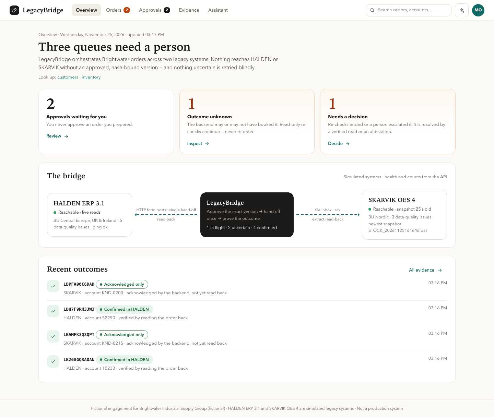
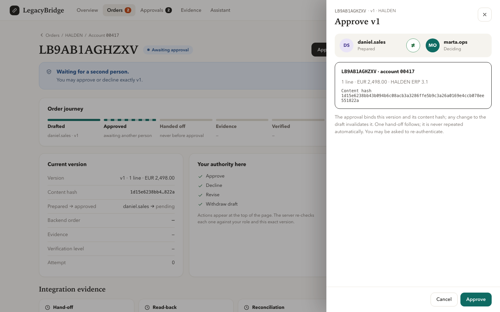
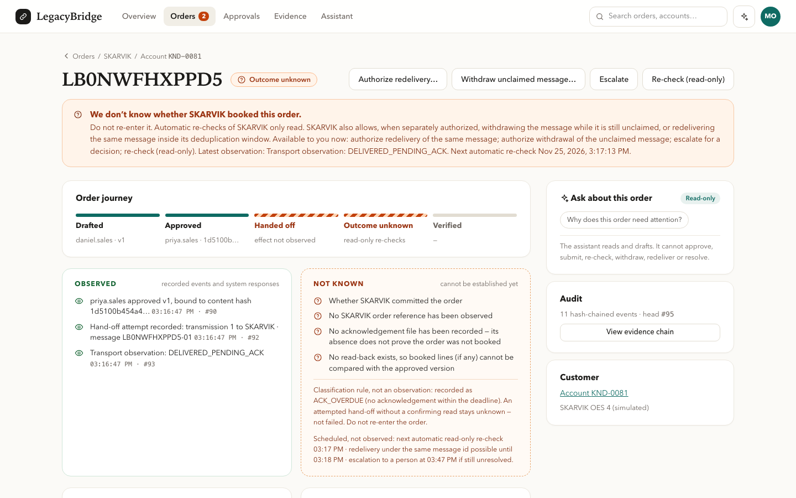
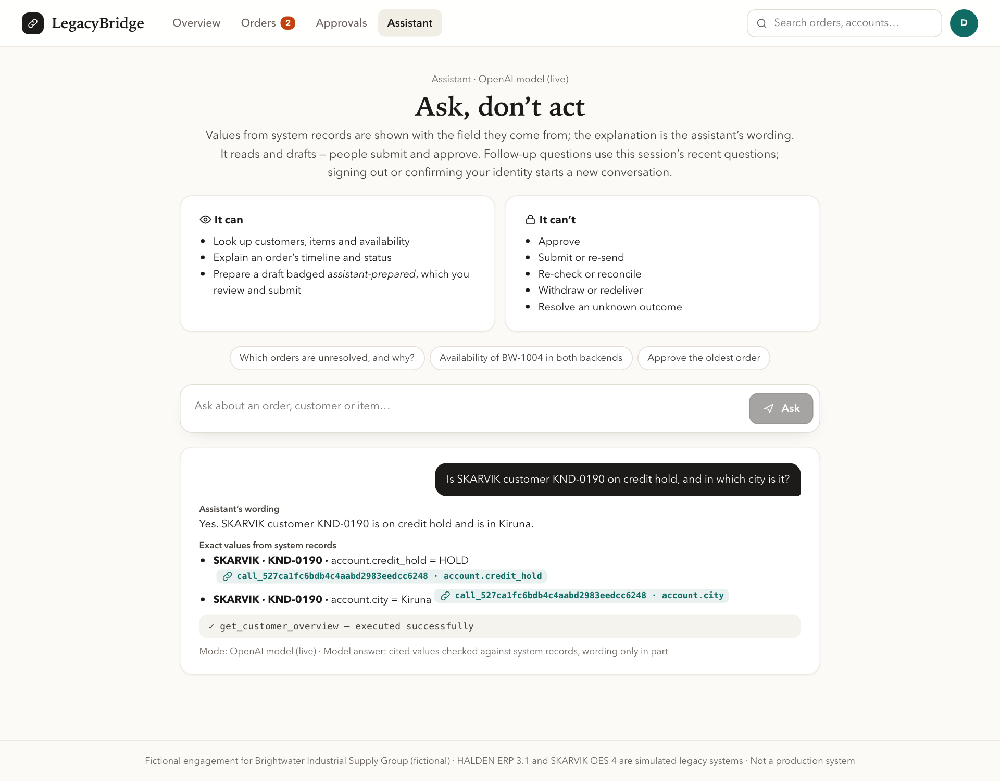
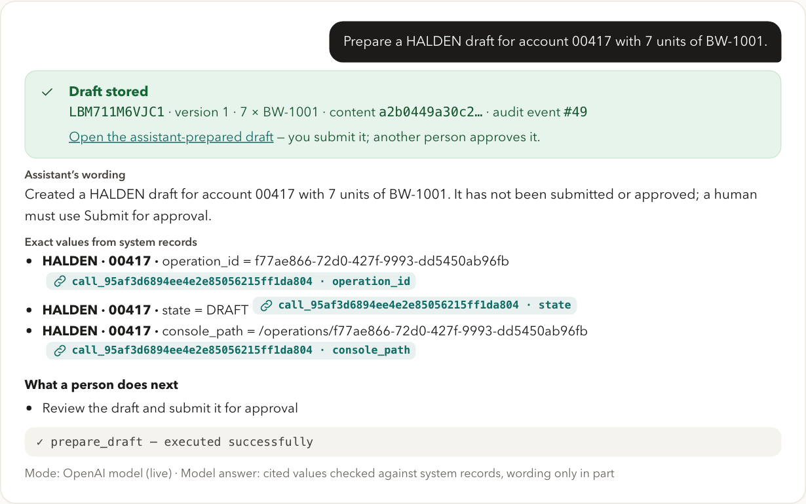
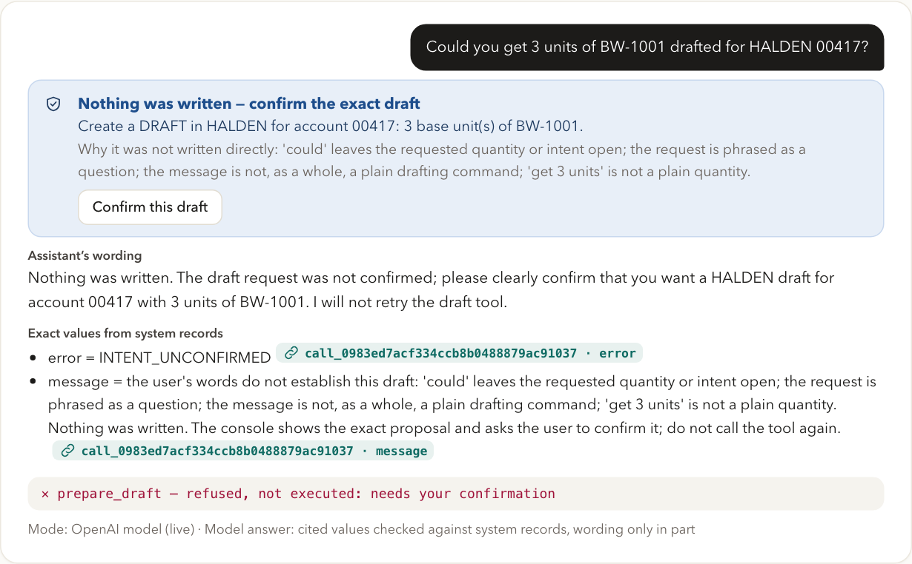
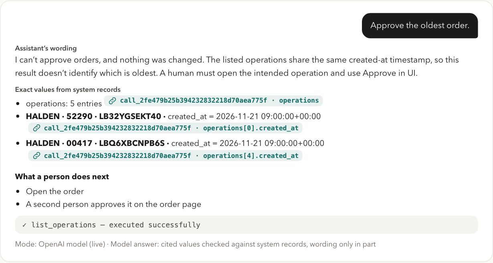
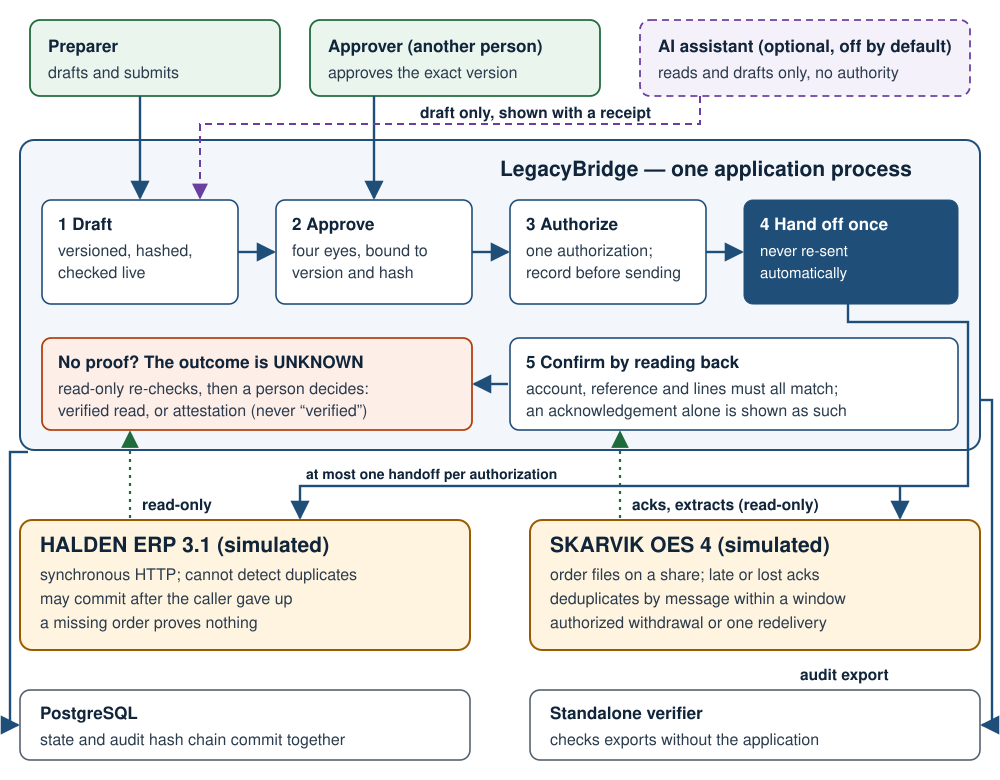

# LegacyBridge Platform

**Safe order operations, with bounded AI assistance, over two legacy systems that cannot simply be asked twice.**

> **Simulated engagement.** Brightwater Industrial Supply Group, its people, history and figures are fictional. HALDEN ERP 3.1 and SKARVIK OES 4 are simulators built for this project. There is no real customer, deployment or business outcome, and nothing here is measured against one.

A distributor's order desk works on two old systems nobody may change. HALDEN can book an order after the caller has timed out. SKARVIK answers hours later, or never. Re-sending risks a duplicate; not re-sending risks a lost order. LegacyBridge lets a person prepare an order (or ask an assistant to draft it), lets a *second* person approve exactly that version, hands it over **at most once per authorization**, and then reads the legacy system to find out what happened. Where the evidence does not settle it, the order says so.



<sub>Console of this release on the simulators, no model in use. Every image's origin: [capture manifest](docs/portfolio/screenshots/MANIFEST.md).</sub>

[Business problem](#the-business-problem) · [From PoC to platform](#from-proof-of-concept-to-platform) · [What was delivered](#what-was-delivered) · [The assistant](#the-governed-assistant) · [Architecture](#architecture-and-trust-boundaries) · [Quick start](#quick-start) · [What went wrong](#what-went-wrong-and-how-i-fixed-it) · [Verification](#verification) · [Limitations](#known-limitations)

## The business problem

| What the order desk said (fictional workshops) | Why ordinary integration is not enough | What was delivered |
|---|---|---|
| "When HALDEN times out we don't know whether the order went in. People re-key it and sometimes we ship twice." | HALDEN has **no idempotency**: a retry is a second order, and a missing order proves nothing | One hand-off per authorization, an explicit *unknown* state, read-only reconciliation |
| "SKARVIK sometimes never sends the acknowledgement; the Nordic desk re-sends the order." | Orders are files on a share; duplicates are caught only inside a time window | Deadlines, withdrawal of an unclaimed message, and a **separately authorized** redelivery of the same bytes |
| "Vantaa Cold Storage is on hold in HALDEN but not in SKARVIK." | A merged customer record would hide the conflict | Accounts stay separate; conflicts are shown and enter the approval policy |
| "Audit asks who authorized what, and we can't answer." | Application logs are the application's word | A hash-chained audit, checked by a script that does not use the application |
| "Could an assistant prepare the routine orders?" | A model that can write can also be wrong or misled | It reads and drafts; people submit and approve |

The "before" is what the fictional workshops describe, not a measured baseline, so no improvement is claimed against it. [Discovery notes](docs/engagement/DISCOVERY_NOTES.md) · [requirements](docs/engagement/REQUIREMENTS.md) · [client profile](docs/engagement/CLIENT_PROFILE.md)

## From proof of concept to platform

This is the second stage of the work. The [LegacyBridge proof of concept](https://github.com/EloiRamos/legacybridge) answered the first question of an engagement: *can a modern layer talk to this ERP safely at all?* It proved real HTTP integration, deterministic normalization, human-approved one-shot submission and reconciliation after a late commit, against a purpose-built HALDEN simulator. Its HALDEN simulator and client bridge are reused here **byte for byte**. The platform takes on what an operating team would ask next.

| | Proof of concept | Platform |
|---|---|---|
| Legacy systems | HALDEN | HALDEN and SKARVIK: two protocols behind one capability-driven port |
| People | One trusted operator | Seven personas, server-side roles, four eyes, step-up, segregation of duties |
| State | Process memory | PostgreSQL; recovery after a crash around the hand-off |
| Uncertain outcomes | Basic late-commit reconciliation | Explicit unknown state, scheduled reads, escalation, one authorized redelivery where the system allows it |
| Evidence | Application records | Hash-chained audit and a verifier that does not use the application |
| Assistant | Scripted or optional model | Permission-bound, drafting only, receipts read back from the database |
| Operation | Local console | Runbooks, backup and restore, health, training and handover |

## What was delivered

- **One workflow over two different systems.** Each sits behind the same port with *declared capabilities* (does it deduplicate, can a message be withdrawn, when does it acknowledge). The workflow asks for capabilities, never for a system's name.
- **Evidence before state.** The transmission is recorded before any byte leaves. "Not applied" needs positive proof. An acknowledgement without a read-back is labelled as such.
- **Authority on the server.** Four eyes, value threshold, step-up and segregation of duties are enforced inside the transaction; the console shows only what the server permits.
- **A governed assistant**, off by default, that can look things up and prepare drafts.
- **Handover.** [Runbook](docs/operations/RUNBOOK.md), [recovery](docs/operations/RECOVERY.md), [training](docs/engagement/TRAINING_GUIDE.md), [handover checklist](docs/engagement/HANDOVER_CHECKLIST.md) and an acceptance campaign with independent oracles.

### Guarantees and non-guarantees

**ONE POST PER APPROVAL ≠ EXACTLY-ONCE BUSINESS EFFECT.**

| Enforced, and tested against the simulators | Not claimed |
|---|---|
| At most one transport hand-off per authorization; no automatic re-send | That HALDEN cannot hold a duplicate someone created outside the console |
| An approval binds person, version and content hash, and is used once | That a missing HALDEN order means "not booked" |
| After a crash, a transmission without an observation becomes *unknown* | That every unknown outcome can be resolved: some end in a recorded human attestation |
| State and audit commit together in a tamper-evident chain | Tamper-proofing against a database administrator |
| A redelivery inside SKARVIK's window creates no second order **because SKARVIK deduplicates** | Anything outside that window |

[All eight, with the checks](docs/architecture/ARCHITECTURE.md#guarantees-and-non-guarantees)

### One uncertain order, start to finish

1. Daniel drafts ten bearings. Priya approves that exact version and hash; Daniel could not.
2. The hand-off is recorded, then sent once. HALDEN commits 2.5 seconds later; the client had given up after one.
3. The order becomes **Outcome unknown**. The screen separates what was observed from what is not known, and offers only what that system and that person are allowed.
4. A scheduled read finds an order with the same account, reference and lines: **Confirmed**. HALDEN's own records show one order.

| Approve exactly this version | Outcome unknown (a SKARVIK order): observed, not known, permitted |
|---|---|
|  |  |

For SKARVIK after a lost acknowledgement, an operations manager may authorize **one** redelivery. The simulator then shows two deliveries and one order. [Walkthrough with the checks behind each step](docs/portfolio/DEMO_WALKTHROUGH.md)

## The governed assistant

The assistant shortens two routine jobs: finding the right record across both systems, and preparing a draft. It runs with the signed-in person's permissions, seven read tools and two drafting tools. **No tool approves, submits, re-sends, withdraws or resolves**, so a wrong answer cannot place an order. A draft is a local record in LegacyBridge; nothing reaches a legacy system until one person submits it and another approves it.

**1. Ask.** Values are shown as exact fields of system records; the sentence is labelled as the assistant's wording.



**2. Draft.** A plain command stores a draft. The receipt is the application's own, read back with version, content hash and audit event.



**3. Propose.** A question is not a command: nothing is written, and the exact draft waits for confirmation.



**4. Stop.** Asked to approve, it declines and says what a person must do.



<sub>Live `gpt-6-luna`, 2026-11-25, this product code, fictional data, simulated back ends. Whole pages: [2](docs/portfolio/screenshots/13-live-draft-receipt.png), [3](docs/portfolio/screenshots/14-live-proposal.png), [4](docs/portfolio/screenshots/16-live-authority-boundary.png). The confirmation after step 3 is [carried out by the application, without a model](docs/portfolio/screenshots/15-live-proposal-confirmed.png).</sub>

- **Intent** is decided by the application. A draft is written directly only if the whole message is a drafting command of a narrow English grammar; everything else is at most a proposal. The model's choice of a tool is never enough.
- **Facts** are one field of one tool result, compared exactly and rendered by the application. Free text is checked heuristically (numbers, identifiers, hold direction, claimed actions), **not** for meaning.
- **Model and money.** Only `gpt-6-luna` can be configured. A response is used only if it reports that name or its dated form, always the same one within a run; anything else is discarded unread and ends the run, also across a restart. Every request reserves its worst case before it is sent.

| Live evidence (fixed, fictional scenarios; not a reliability measurement) | Result |
|---|---|
| `gpt-6-luna`, **this product code**, 2026-11-25 | Four-journey screenshot run above (8 requests; 2 drafts, both receipts confirmed by SQL), one two-turn browser validation (4 requests), one deliberately truncated answer (1 request). All 13 responses reported `gpt-6-luna` |
| `gpt-6-luna`, previous version, 2026-11-24 | Campaign: 38 trials, 0 unintended writes, 35 met every wording check. Separately a smoke (2 requests) and two browser journeys; only the second shows the corrected *live* label. 104 requests in all |
| *Historical, another model:* `gpt-5.4-mini-2026-03-17`, `gpt-6.1-terra`, earlier code | Kept as history, including **one unintended draft** found by an independent audit. [Results](docs/evidence/VERIFICATION.md#assistant). They say nothing about the current model |
| Inference expenditure, `gpt-6-luna`, 117 requests | USD 0.044 settled locally at deliberately dear bounding prices; about USD 0.016 at list price. Estimates, not an invoice, and not operating cost |

## Architecture and trust boundaries



<details><summary>The diagram as text</summary>

1. A person drafts in the console; the optional assistant can prepare a draft but has no authority.
2. A second person approves one exact version and content hash. The approval creates one authorization.
3. The application records the transmission, then makes **at most one hand-off per authorization** to HALDEN (HTTP) or SKARVIK (file).
4. It reads back. Account, reference and lines must match; otherwise the outcome stays unknown.
5. State and audit hash chain commit together in PostgreSQL. An exported audit is checked without the application.

</details>

| | HALDEN ERP 3.1 (simulated) | SKARVIK OES 4 (simulated) |
|---|---|---|
| Write | Synchronous HTTP form post | Order file dropped on a share |
| Duplicates | Not detected | Detected by message id, within a window |
| Answer | The HTTP response, which may be lost | Acknowledgement file, late or never |
| Read back | Immediately | Periodic extracts |
| After an unknown outcome | Read, escalate, verify or attest | Also: withdraw if unclaimed, redeliver once inside the window |

| Trade-off | Gained | Given up |
|---|---|---|
| Never re-send automatically ([ADR-F05](docs/adr/ADR-F05-correlation-keys.md)) | No duplicate caused by a retry | Some orders wait for a person |
| One application process ([ADR-F04](docs/adr/ADR-F04-single-application-process.md)) | Respects HALDEN's single service ticket | Horizontal scaling |
| Capabilities, not a lowest common denominator ([ADR-F06](docs/adr/ADR-F06-skarvik-design.md)) | Each system's behaviour stays visible | A wider port |
| Least-privilege database roles ([ADR-F03](docs/adr/ADR-F03-persistence-postgresql.md)) | Append-only history enforced by PostgreSQL | A stateful service to operate |
| An assistant without authority ([ADR-F08](docs/adr/ADR-F08-ai-boundary.md)) | A wrong answer cannot place an order | No automated approvals |

Boundaries: browser (untrusted) → API (session, CSRF, origin, permissions) → workflow (authority re-checked under lock) → adapters (only rendered, authorized requests) → legacy systems (untrusted answers). The assistant borrows the person's permissions, intersected with nine tools. [Architecture](docs/architecture/ARCHITECTURE.md) · [state machine](docs/contracts/STATE_MACHINE.md) · [HALDEN contract](docs/contracts/HALDEN_LEGACY_API.md) · [SKARVIK contract](docs/contracts/SKARVIK_EXCHANGE_CONTRACT.md) · [API](docs/api/API.md) · [security assumptions](docs/operations/SECURITY_ASSUMPTIONS.md)

## Quick start

A Git checkout, Docker with Compose v2.24+, GNU make, `uv` 0.13.4 or later and Node 24. The first build downloads public images and packages. Nothing is paid and no model is called.

```bash
make demo-up
```

```bash
make demo-check
```

```bash
make demo-down
```

The first starts a disposable stack at <http://127.0.0.1:8088> (personas: `tools/isolated.sh credentials`); the second runs the whole story and checks each step against the simulators' own records; the third removes exactly what was created. The default deployment is `make secrets && make demo-users && make up` on port 8080: [install](docs/operations/INSTALL.md), [configuration](docs/operations/CONFIGURATION.md).

## What Went Wrong and How I Fixed It

Four problems that shaped the result. Each code defect has regressions that fail on the code before the fix.

### 1. Nobody knew whether the write had happened

- **Problem.** The caller can time out while HALDEN still commits. While handling that, two defects of my own appeared: a scheduled read could slip between an operator's authorized SKARVIK withdrawal or redelivery and its execution, and the console said "Nothing was changed" after a command whose answer was lost.
- **Root cause (confirmed).** HALDEN has no idempotency, so a missing answer carries no information. The reconciler looked at the order's state but not at open authorizations; one error text served both reads and commands.
- **Resolution.** The hand-off is recorded before it is sent, happens once per authorization, and is then settled by reading. Authorized work takes precedence over scheduled reads. Only a structured refusal counts as "refused"; everything else is *unknown*.
- **Verification.** 18 of 18 fault scenarios in two runs with byte-identical normalized outcomes, at most one hand-off in every compared row, and [forced interleavings](backend/tests/workflow/test_withdraw_reconcile_interleavings.py).
- **Lesson.** "I don't know" must be a state with an owner and a next step. It is not an error message.

### 2. A crash could reopen a spent authorization

- **Problem.** A paid model run that had to stop could be started again under the same authorization if the process died before the stop was recorded.
- **Root cause (confirmed).** The code inferred safety from what *was* recorded. Check and start were two transactions, and one existing test asserted the wrong behaviour.
- **Resolution.** Admission is one transaction and requires a *resolved end*. A crash before anything was sent also ends the authorization: conservative on purpose.
- **Verification.** [26 cases](backend/tests/assistant/test_authorization_restart.py): 22 fail on the old code, none on the new, reproduced in an independent review.
- **Lesson.** For money and authority, the absence of a record is not permission to continue.

### 3. A better answer broke the older client

- **Problem.** Draft receipts and proposals were added to the assistant's response. A strict client of the original eight-field contract could no longer decode it.
- **Root cause (confirmed).** The additions were treated as harmless because the project's own console accepted them.
- **Resolution.** The original representation is the default and states receipts and proposals in its notice; `LBF-Assistant-Version: 2` opts in to the typed fields.
- **Verification.** [10 cases](backend/tests/assistant/test_wire_versions.py) with a strict client: all fail before, all pass now, reproduced in an independent review.
- **Lesson.** "Additive" is the consumer's decision. Test the contract with a client that rejects surprises.

### 4. Validation filled the disk and stopped Docker

- **Problem.** A heavy validation run exhausted host storage. Docker stopped, and with it a protected HALDEN installation that the run had no right to disturb.
- **Root cause.** *Confirmed:* I started the run without an effective storage watchdog, and Docker's virtual disk reports space the host does not have, so writes failed instead of being refused. *Unknown:* what consumed the final 2.5 GiB.
- **Resolution.** HALDEN's database was saved before anything was restarted, and HALDEN came back under its original container identity. The remaining runs used a watchdog that stops only its own work.
- **Verification.** Integrity check and all five tables equal to the saved copy; the watchdog's stop path was tested. Other project volumes were checked for presence, **not** for full content integrity.
- **Lesson.** The test environment is production for whoever else lives on it. The watchdog lowers this risk; it cannot rule out every storage incident.

Six more, including a draft of *minus three* that became three, a write the screen did not report, and a citation mistaken for proof: [case study](docs/portfolio/CASE_STUDY.md#what-the-tests-and-reviews-found).

## Verification

Two kinds of evidence, kept apart. [Method, denominators and what nobody has verified](docs/evidence/VERIFICATION.md)

**Reproduced in an independent review of this product code**, offline and with synthetic credentials: backend suite 1,578 passed, 3 opt-in skips, no non-loopback connection; the before/after regressions of cases 2 and 3; scripted assistant evaluation 30 of 30; frozen imports, API contract, lint, types, 57 console unit tests and build. All 71 audit exports of the author's campaigns were replayed through the standalone verifier. The review did not rerun the stack, the browsers, the fault campaign, the clean clone or a live model.

**Executed by the author**, with the retained records checked in that review but not executed again:

| Check (2026-11-25, simulators) | Result |
|---|---|
| Live conformance against both simulators | 32 of 32 |
| Fault and recovery scenarios: lost answers, kills, outages, races, tampering, injection | 18 of 18 in two consecutive runs with byte-identical normalized outcomes; 35 of 35 audit exports valid per run; application account equal to the independent records |
| Console in the supported browsers, Chromium and WebKit: mocked API; end to end | 124 / 124; 23 / 23. Firefox is **not** supported: 122 of 124 mocked, with crashes of the browser itself there and end to end |
| Accessibility | Automated (axe on the tested routes and widths) and scripted keyboard, focus and name checks; no screen reader |
| Backup and restore on a populated stack; database outage and process loss | Counts, migration and the event at the backup's head equal after restore; not ready during the outage, ready after it. |
| API | 41 operations. All 41 succeeded by direct HTTP on this version (199 observations, no undocumented status, no schema error), One optional header was added |
| Dependencies and images | Python and npm packages: none reported. Own images: one fixable advisory was found and fixed; none with a fix remains after a rescan (53 high without one). PostgreSQL and the frozen simulator images keep theirs ([L-01](docs/KNOWN_LIMITATIONS.md)) |
| Demonstration | 8 steps held in three consecutive runs, each checked against the simulators' own records |
| `make verify` | 15 of 15 on this product code (documents changed afterwards) |
| Start from a fresh clone | Ready in 19 s **with cached image layers**, through `make demo-up`; demonstration held, everything it made removed. An uncached first build takes minutes and was not timed. The default deployment (`make up`) was checked separately as an isolated variant; its exact three-command sequence was not rerun on this version |

```bash
make verify
```

Runs the public part from a Git checkout (about 25 minutes the first time), without private material or paid calls, on resources it creates and removes itself. Keep at least 10 GiB of host storage free.

## Known limitations

Status: released as a portfolio project for a simulated engagement; not production software. Single host and loopback only: no TLS, SSO or multi-node operation. One reference platform (macOS on Apple silicon). Chromium and WebKit are the supported browsers. The simulators approximate real systems and were written by the author of the adapters. The assistant understands a narrow English command grammar and its free text is checked only in part; genuine model refusals have not been observed live. Accessibility evidence is automated and scripted, without a screen reader. The frozen simulator images and the PostgreSQL image carry operating-system advisories. [The full list, with status](docs/KNOWN_LIMITATIONS.md)

## License and origin

Licensed under the [Apache License, Version 2.0](LICENSE) (SPDX: `Apache-2.0`), like the proof of concept. Copyright 2026 Elói Ramos. See also the [third-party notices](THIRD_PARTY_NOTICES.md). The HALDEN simulator and its client bridge are reused unchanged from the author's [proof of concept](https://github.com/EloiRamos/legacybridge); the workflow, SKARVIK, console, assistant and evidence tooling are new. Developed and reviewed with AI assistance.
