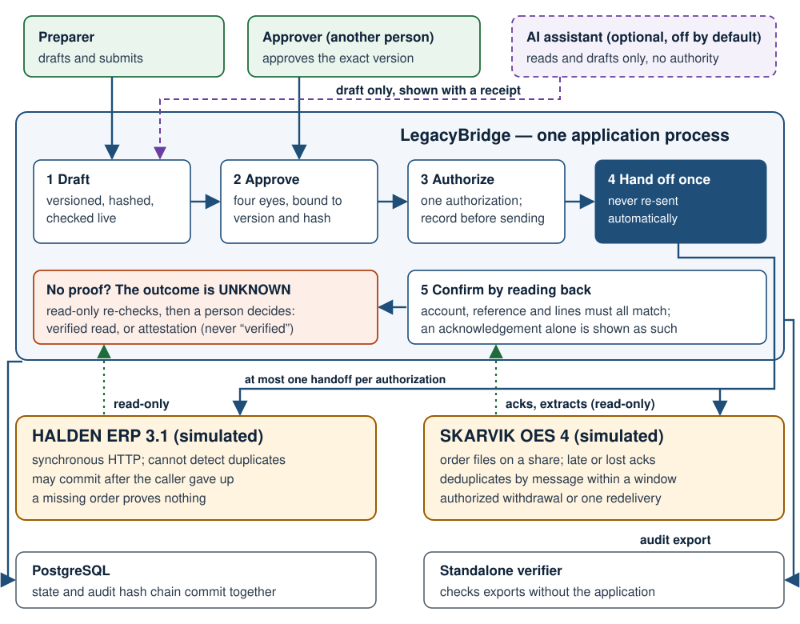
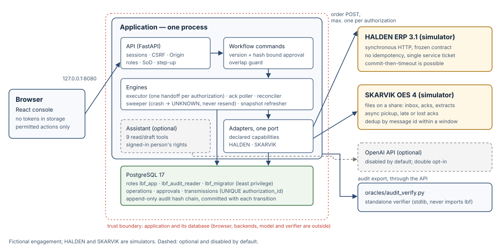
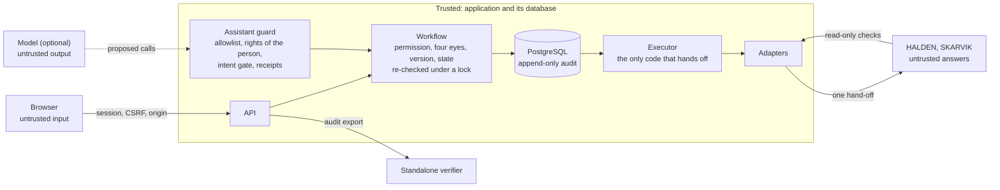

# Architecture

Fictional engagement; HALDEN ERP 3.1 and SKARVIK OES 4 are simulators. This document describes the system as built. Decisions are recorded as ADRs in [docs/adr](../adr/README.md); normative contracts are in
[docs/contracts](../contracts/).

Components and trust boundary:

Diagram source: [components.mmd](components.mmd).

## 1. The central rule

The order desk must place orders in two legacy systems whose write paths cannot be made safe to repeat: HALDEN has no
idempotency at all, and SKARVIK deduplicates only for a bounded window. LEGACYBRIDGE therefore guarantees **at most one
handoff per human authorization**, records every handoff before it happens, and treats every outcome it cannot prove
as `UNKNOWN` — to be reconciled by reading the backend, never by sending again.

**ONE POST PER APPROVAL ≠ EXACTLY-ONCE BUSINESS EFFECT.**

A HALDEN order can still be booked twice if a human creates a second, separately approved order for the same goods
while the first is `UNKNOWN` (the overlap guard requires an audited override for that), or if anyone books outside
this system.
### Guarantees and non-guarantees

| Guaranteed against the simulators and the tested fault model | Checked by | Not claimed |
|---|---|---|
| G1 At most one transport handoff per authorization | `UNIQUE(authorization_id)`; wire-tap and SKARVIK ledgers in R01–R18 | Exactly-once business effect on HALDEN |
| G2 No automatic resend of a non-idempotent write | Boundary test B-6; R02–R05, R11 | That HALDEN writes can be repeated safely |
| G3 Approvals bind actor, operation, version and content hash, and are consumed once | C-02, C-03, R07, R08 | That a missing order proves "not booked" on HALDEN |
| G4 After a crash, every transmission without an observation surfaces as `UNKNOWN` | R11, R12 | That application logs prove external side effects |
| G5 `NOT_APPLIED` only with positive evidence of non-processing | CF-06, R01, R11, audit verifier | Production readiness or commercial outcomes |
| G6 State transitions and audit events commit atomically in a tamper-evident chain | E-01…E-06, R18 | A tamper-proof audit against a privileged database administrator |
| G7 The assistant has no tool that approves, submits, redelivers, withdraws, resolves or administers, and writes a draft only from a whole-message command or a confirmed proposal | AI-SEC-01…07, R17, `test_receipt_integrity`, `test_intent_grounding_reproduction`, `test_write_integrity*` | That prompt instructions are a security boundary, or that free text is verified |
| G8 A byte-identical SKARVIK redelivery inside the dedup window creates no second order **because SKARVIK deduplicates** | CF-13, scenario 2b | Any SKARVIK guarantee outside that window |

## 2. Components

| Component | Code | Responsibility |
|---|---|---|
| Console | `frontend/` (React 19, TypeScript, Vite, TanStack Query, React Router) | Server-owned state only; every action button is rendered from the server's `permitted_actions`; no tokens in browser storage |
| API | `backend/src/lbf/api/` (FastAPI) | Sessions, CSRF token + Origin check, step-up, problem details, OpenAPI contract `docs/api/openapi.json` ([API.md](../api/API.md)) |
| Workflow | `backend/src/lbf/workflow/` | Drafts and versions, validation snapshots, approvals bound to version + content hash, authorizations, overlap guard I5, escalation and resolution; every command re-checks permission, SoD and state under a row lock |
| Engines | `backend/src/lbf/engines/` | Executor (claims an authorization, commits the transmission row, then hands off once), acknowledgement poller, reconciler (read-only matching), sweeper (lease expiry ⇒ `INTERRUPTED` ⇒ `UNKNOWN`), snapshot refresher; singleton lease |
| Domain | `backend/src/lbf/domain/` | Canonical model, state machine (T01–T32 + T18b), evidence classes and outcome mapping, canonical JSON and content hash |
| Ports and adapters | `backend/src/lbf/ports/`, `backend/src/lbf/adapters/` | One backend port with declared capabilities; HALDEN adapter wraps the frozen v1 bridge; SKARVIK adapter renders/parses the exchange files (defusedxml for acks) |
| Persistence | `backend/src/lbf/persistence/` | PostgreSQL 17, Alembic migrations, least-privilege roles, append-only triggers, audit hash chain |
| Assistant | `backend/src/lbf/assistant/` | Optional; 9 read/draft tools through a guard; guided-intent router without a model; intent gate, receipts and typed facts; bounded in-memory conversation per server session; OpenAI Responses API provider behind double opt-in ([ADR-F10](../adr/ADR-F10-openai-provider.md)) |
| Simulators | `legacy-systems/halden-erp/` (frozen v1 import), `legacy-systems/skarvik-oes/` (frozen) | The two legacy systems, with fault controls available only in `demo`/`test` |
| Evidence tooling | `oracles/`, `tools/wiretap/`, `resilience/`, `acceptance/` | Independent oracles, recording proxy, resilience runner, end-to-end control ([ADR-F11](../adr/ADR-F11-evidence-architecture.md)) |

All of API, workflow and engines run in **one process** (ADR-F04): HALDEN allows a single service ticket, and a
second process would revoke the first one's ticket.

## 3. Write path

1. **Draft** (sales ops): canonical lines are normalized per backend (units, item codes, account ids) into a draft
   version with a content hash; validation records stock, hold and value checks as a snapshot.
2. **Submit for approval**, then **approve** (another person; ≥ €2,500 needs the operations manager): the approval
   binds the exact version and content hash, re-runs the overlap guard and policy under the row lock, and creates one
   `SUBMIT` authorization with an expiry. A stale version, wrong hash, self-approval or missing step-up is refused.
3. **Executor**: claims the authorization, commits the transmission row (`UNIQUE(authorization_id)`), and only then
   calls the adapter's `handoff` once. The observation (`ACCEPTED`, `REJECTED`, `UNCERTAIN`, `NOT_DELIVERED`,
   `DELIVERED_PENDING_ACK`, …) is recorded with response hash and excerpt.
4. **Outcome**: a definite answer finalizes the operation; anything uncertain moves to reconciliation. HALDEN: the
   reconciler reads orders by correlation reference and requires a full match (account, reference, lines). SKARVIK:
   acknowledgements are matched by message id; snapshots (extracts) confirm read-back; a `REJECTED` ack is finalized
   only after a confirming extract read (T18/T18b).
5. **UNKNOWN** is worked by scheduled read-only re-checks, then escalated (`RECHECK_LIMIT`, age). A human resolves it
   by a **verified** read (the system reads the named order and confirms only on a full match) or by **attestation**
   (closed as "not verified", with an external reference). On SKARVIK, an operations manager may authorize **one**
   byte-identical redelivery inside the dedup window, or withdraw an unclaimed file before pickup.

`NOT_APPLIED` requires one of the evidence classes `NOT_SENT`, `PRE_PROCESSING_REFUSAL`, `NEVER_DELIVERED`,
`WITHDRAWN_BEFORE_PICKUP`, `APPROVAL_EXPIRED`; the standalone verifier checks this rule on every export.

## 4. Recovery

The transmission row exists before any byte leaves the process. If the process dies, the sweeper finds transmissions
whose lease expired without an observation, marks them `INTERRUPTED` and moves the operation to `UNKNOWN`. On HALDEN
that `UNKNOWN` can never become `NOT_APPLIED` (absence of an order is not proof); on SKARVIK, a leftover staging file
in place of a delivered one proves `NEVER_DELIVERED`. Schedules resume from stored timestamps (R11, R12).

## 5. Trust boundaries

| Boundary | Controls | Negative tests |
|---|---|---|
| Browser → API | SameSite=Strict HttpOnly session cookie, synchronizer CSRF token, Origin check, CSP `default-src 'self'`, server-side permissions, version/hash binding | SEC-01…SEC-08 |
| API → workflow | Permission, SoD and state re-checked under lock in every command | ST-NEG-*, SEC-09 |
| Assistant → tools | Allowlist of 9 tools, human principal ∩ allowlist, strict argument schemas, intent gate before any draft, application-made receipts, result caps, untrusted text wrapped | AI-SEC-01…07, R17, `test_receipt_integrity.py` |
| App → OpenAI API | Disabled by default; double opt-in; key file mounted only into `app`; official endpoint pinned; SDK retries off; budgets with reservation | AI-OAI-*, AI-COST-* |
| Workflow → adapters | Only the executor and the withdraw handler may call `handoff`/`redeliver`/`withdraw_unclaimed` (import-boundary test B-6) | B-6 |
| Adapters → backends | Credentials only in the app container; responses untrusted (size limits; defusedxml for SKARVIK; HALDEN's XML parsed by the frozen v1 bridge under [ADR-F09](../adr/ADR-F09-halden-xml-trust.md)) | SEC-10, SEC-11 |
| App → PostgreSQL | `lbf_app` cannot alter audit/approval history; append-only triggers; SQL transition trigger | SEC-12, SEC-13 |
| Audit → compliance | Hash chain; exports with manifest and head hash; standalone verifier | E-01…E-04 |
| Simulation controls | Off in the `default` profile; demo router only in `demo`/`test`; `demo.control` only for the sysadmin | SEC-14, SEC-15 |
| Network exposure | Only `127.0.0.1:8080` published in `default` | SEC-16 |

Residual risks: [SECURITY_ASSUMPTIONS.md](../operations/SECURITY_ASSUMPTIONS.md) and
[KNOWN_LIMITATIONS.md](../KNOWN_LIMITATIONS.md).

## 6. Deployment shape

Docker Compose, profiles `default` / `demo` / `test` ([ADR-F12](../adr/ADR-F12-deployment-and-recovery.md)):
`db` (PostgreSQL 17), one-shot `migrate`, `halden`, `skarvik`, `app`; the `test` profile adds the recording wire-tap
and publishes test ports on loopback. Operations: [docs/operations](../operations/).

## 7. Evidence

What was run, on which code and with which result: [VERIFICATION](../evidence/VERIFICATION.md). The application's own
logs and audit are its account; independent truth comes from the wire-tap ledger, HALDEN reads by an independent client,
and SKARVIK's own ledgers ([ADR-F11](../adr/ADR-F11-evidence-architecture.md)).
